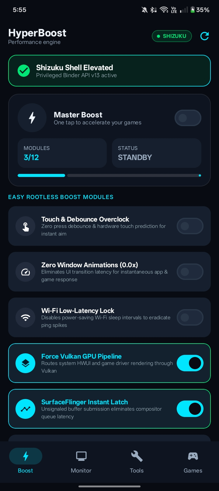
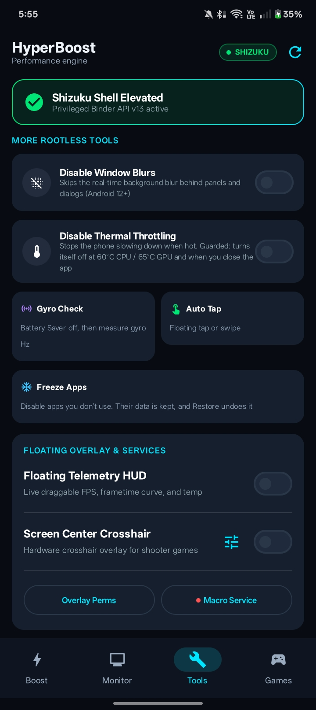
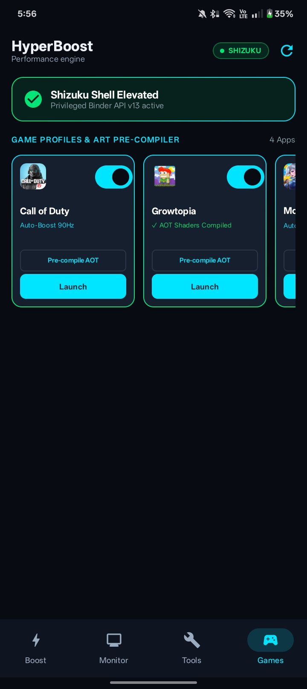
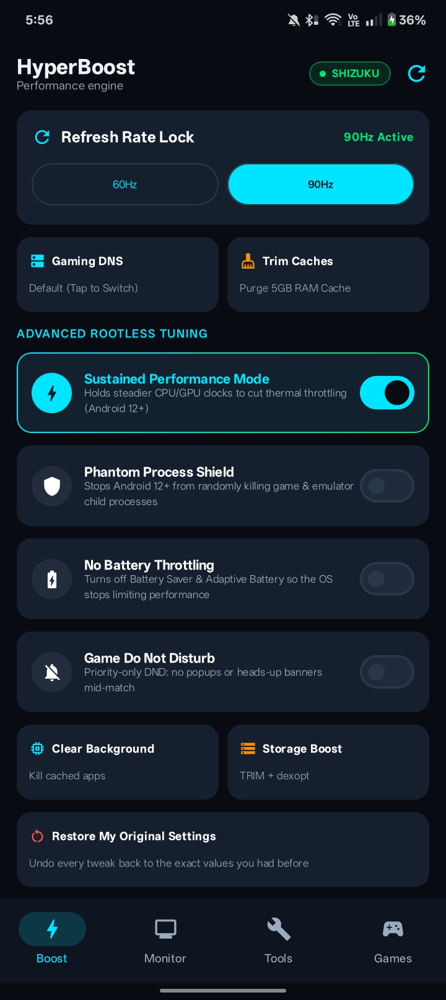

# ⚡ HyperBoost Engine Pro

### Android Gaming Toolkit · Shizuku · Rootless Tuning · Floating Tools

A gaming companion for Android that brings supported system tuning, live performance telemetry, game profiles, floating overlays, and automation tools into one place.

[🌐 Official Website](https://hyperboost-engine-pro.vercel.app) · [⬇️ Latest APK](https://github.com/A-124/hyperboost-engine-pro/releases/latest) · [📋 All Releases](https://github.com/A-124/hyperboost-engine-pro/releases) · [🐛 Report a Bug](https://github.com/A-124/hyperboost-engine-pro/issues)

---

## App screenshots

  
  
  
  

## About HyperBoost Engine Pro

**HyperBoost Engine Pro** is an Android gaming toolkit built to make supported device controls and gaming utilities easier to find and manage. It combines Shizuku-backed tuning, available performance telemetry, per-game preferences, floating tools, and restore support in one app.

The app is designed to work without requiring root. Shizuku provides elevated ADB-level access for supported operations, while overlays and automation may need their own Android permissions. What can be read or changed depends on the Android release, device manufacturer, game, permissions, and active Shizuku session.

HyperBoost gives you tools to tune and monitor your setup. Actual performance changes vary by device and game, so use the controls that are available on your phone and keep an eye on temperature during long sessions.

## Features

### 🎮 Gaming hub and profiles
- **Master Turbo:** One place to run supported tuning actions.
- **Per-game profiles:** Keep game-related preferences organized.
- **Refresh-rate selection:** Choose from refresh rates reported as supported by the device.
- **Quick access to tools:** Open gaming controls and overlays from the dashboard.

### 📊 Live telemetry and floating overlays
- **Live FPS / frame pacing HUD:** Displays frame-rate information when Android exposes usable data for the foreground app.
- **Performance telemetry:** Shows available device readings such as battery, memory, temperature, and power information.
- **Crosshair overlay:** Configurable on-screen crosshair for compatible games and devices.
- **Floating tools:** Optional overlay controls that stay accessible while using supported apps.

### ⚙️ Display, input, and system tuning
- **Display resolution scaling:** Offers supported resolution changes, including a lower-resolution option where the device allows it.
- **Refresh-rate controls:** Applies supported refresh-rate settings and can restore the previous behavior.
- **Touch and pointer settings:** Provides supported touch-related, pointer-speed, and debounce controls.
- **Animation controls:** Adjusts supported window and transition animation settings.
- **Graphics / rendering options:** Includes selected Android rendering and SurfaceFlinger-related controls where supported.
- **Wi-Fi and network settings:** Offers selected network-related tuning options exposed by the device.
- **Power and background controls:** Includes supported sustained-performance, battery-management, background-process, and game Do Not Disturb options.
- **Storage maintenance:** Provides a supported maintenance action using Android's idle-maintenance tools.

### 🤖 Automation tools
- **Auto Tap:** Floating tap controls for repeated input, where configured and permitted.
- **Macro automation:** Accessibility-based automation tools for supported workflows.
- **Permission-guided setup:** The app provides entry points to configure Shizuku, overlay, and accessibility access as needed.

### ↩️ Restore and safety features
- **Restore original settings:** The app snapshots original values for supported settings before changing them, then uses those snapshots when restoring.
- **Read-back checks:** Selected operations are checked against the device's reported state where possible.
- **Thermal-aware safeguards:** Some options include guards intended to reduce unsafe or unsuitable use.
- **Status and error feedback:** Unsupported or rejected operations may be reported rather than silently treated as successful.

> **Compatibility note:** Android and device manufacturers restrict different system interfaces. Some readings or controls may be unavailable, and successful application of a setting does not guarantee a specific FPS result. Avoid forcing sustained performance at the expense of device temperature or stability.

## Requirements

- **Android:** Android 8.0 (API 26) or later, with feature-specific compatibility.
- **Shizuku:** Install and start [Shizuku](https://shizuku.rikka.app/) and authorize HyperBoost for Shizuku-backed operations.
- **Overlay permission:** Needed for floating HUD and crosshair tools.
- **Accessibility permission:** Needed for accessibility-based macro automation.
- **Device compatibility:** Available controls depend on the Android build, manufacturer, and hardware.

Grant only the permissions needed for the tools you choose to use.

## Install and get started

1. Open the [latest official GitHub release](https://github.com/A-124/hyperboost-engine-pro/releases/latest).
2. Download the APK attached to the release.
3. Install the APK. Android may ask you to allow installation from the browser or file manager you used.
4. Start Shizuku and authorize HyperBoost if the selected feature requires it. Follow the official [Shizuku setup guide](https://shizuku.rikka.app/).
5. Grant overlay or accessibility access only when you want to use tools that need them.
6. Open the app, review the available controls, and apply changes one at a time.
7. Use **Restore My Original Settings** when you want to revert supported changes made by the app.

**Download safety:** Use the official release page above, check the version and release notes, and avoid unofficial APK mirrors.

## Troubleshooting

- **Shizuku is disconnected:** Start Shizuku again and confirm HyperBoost is authorized.
- **FPS or a metric is unavailable:** Some Android builds restrict access to frame statistics or device telemetry. An unavailable value is not the same as zero.
- **A control is unavailable or rejected:** Check device compatibility, required permissions, and Shizuku status.
- **A floating tool does not appear:** Review the app's overlay permission and the relevant in-app toggle.
- **Macro automation does not run:** Confirm the accessibility service is enabled and review the automation configuration.
- **A setting behaves unexpectedly:** Stop using that option and use restore support where available.
- **Need help?** [Open an issue](https://github.com/A-124/hyperboost-engine-pro/issues) with your app version, Android version, device model, and steps to reproduce. Never post passwords, private tokens, signing keys, or other secrets.

## FAQ

### Does HyperBoost Engine Pro require root?

It is designed as a rootless utility. Some operations use Shizuku, while overlays and accessibility-based tools require their respective Android permissions.

### What can HyperBoost do for my gaming setup?

HyperBoost brings supported tuning controls, live performance information, refresh-rate and display options, per-game preferences, and floating gaming tools into one place. Use the options available for your device to personalize your setup and monitor how it behaves in your games.

### Will every feature work on every phone?

Feature availability varies with Android version, manufacturer software, hardware, game, and permissions. The app may report a control or measurement as unavailable when the system does not expose it.

### Can I undo changes?

The app snapshots original values for supported settings before changing them and provides **Restore My Original Settings** to help revert those changes. Restoration is limited to values the app was able to save and manage.

### Where can I download the newest version?

Use the [latest release page](https://github.com/A-124/hyperboost-engine-pro/releases/latest). The website also links to the official project and release history.

## Official links

- **Website:** https://hyperboost-engine-pro.vercel.app
- **Latest APK:** https://github.com/A-124/hyperboost-engine-pro/releases/latest
- **Release history:** https://github.com/A-124/hyperboost-engine-pro/releases
- **Issues and bug reports:** https://github.com/A-124/hyperboost-engine-pro/issues
- **Shizuku documentation:** https://shizuku.rikka.app/

## License

HyperBoost Engine Pro is proprietary software developed and maintained by **A-124**. All rights are reserved. Refer to the repository's [LICENSE](LICENSE) file for the applicable terms. Do not redistribute or commercially reuse the software unless the license or maintainer explicitly permits it.

---

**HyperBoost Engine Pro** · Your Android gaming setup, in your control

Maintained by [A-124](https://github.com/A-124)

