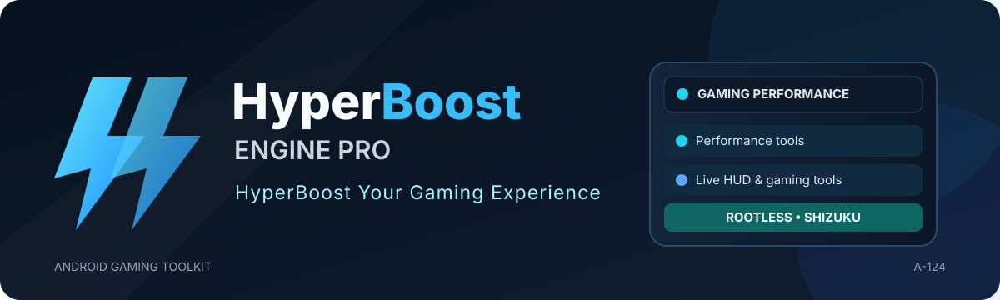
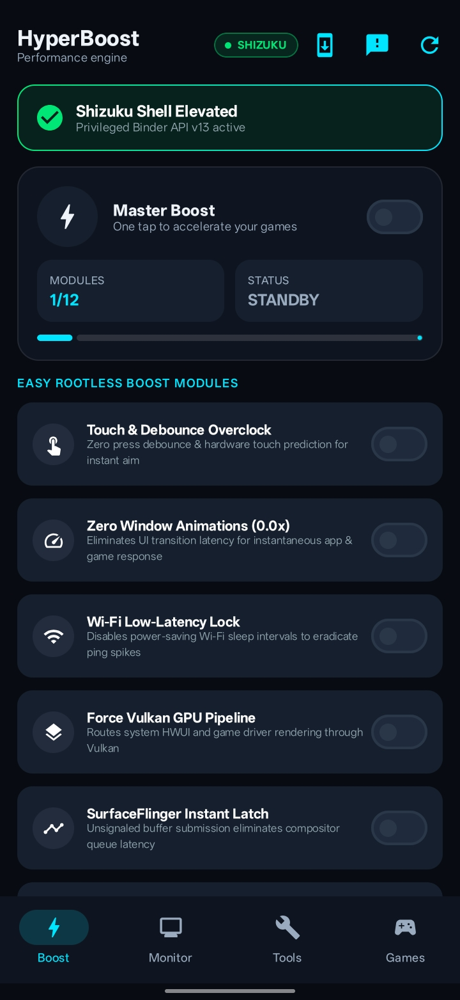
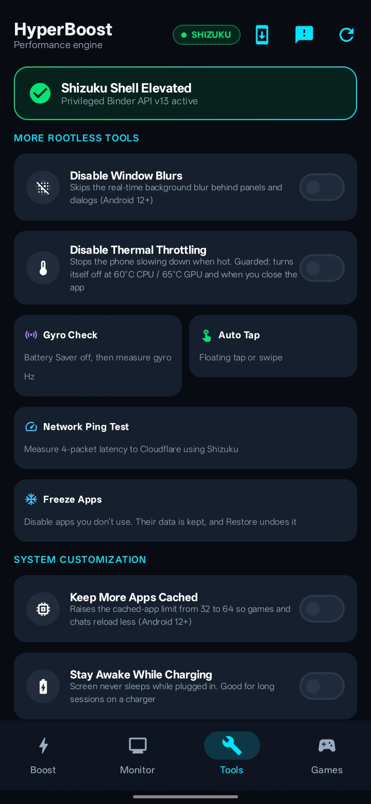
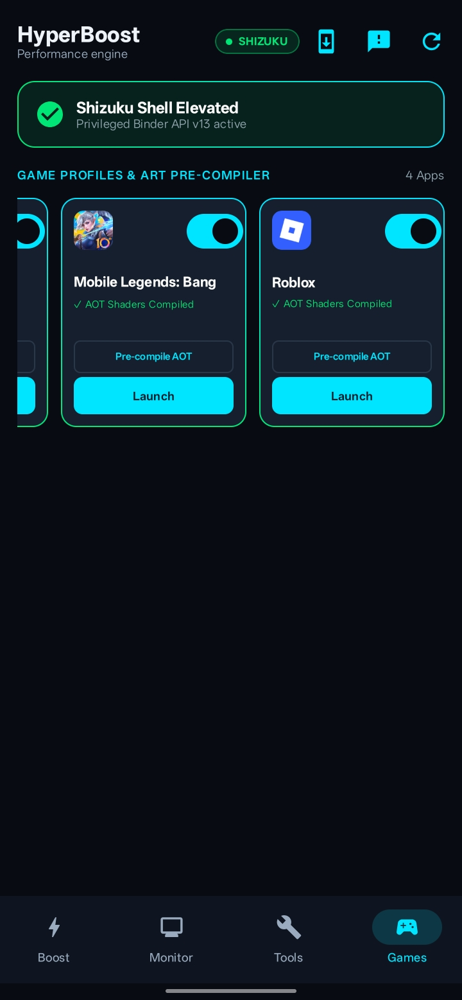

# ⚡ HyperBoost Engine Pro

### Android Gaming Toolkit · Shizuku · Rootless Tuning · Floating Tools

A gaming companion for Android that brings supported system tuning, live performance telemetry, game profiles, floating overlays, and automation tools into one place.

[🌐 Official Website](https://hyperboost-engine-pro.vercel.app) · [⬇️ Latest APK](https://github.com/A-124/hyperboost-engine-pro/releases/latest) · [📋 All Releases](https://github.com/A-124/hyperboost-engine-pro/releases) · [🐛 Report a Bug](https://github.com/A-124/hyperboost-engine-pro/issues)

---

## App screenshots

  
  
  

## About HyperBoost Engine Pro

**HyperBoost Engine Pro** is an Android gaming toolkit that makes supported device controls and gaming utilities easier to find and manage. It combines Shizuku-backed tuning, available performance telemetry, per-game preferences, floating tools, and restore support in one app.

The app is designed to work without root. Shizuku provides elevated ADB-level access for supported operations, while overlays and automation may need their own Android permissions. What can be read or changed depends on the Android release, device manufacturer, game, permissions, and active Shizuku session.

> **Important:** results depend on Android version, OEM restrictions, Shizuku authorization, and the device's thermal/power policies. A control being available in the UI does not guarantee that every device permits it. The app reports unsupported or rejected operations instead of promising universal FPS gains.

## Features

### Gaming hub and profiles
- **Master Turbo:** one place to run supported tuning actions.
- **Per-game profiles:** keep game-related preferences organized.
- **Refresh-rate selection:** choose from rates reported as supported by the device.
- **Quick access to tools:** open gaming controls and overlays from the dashboard.

### Live telemetry and floating overlays
- **Live FPS / frame-pacing HUD:** displays frame-rate information when Android exposes usable data for the foreground app.
- **Performance telemetry:** available battery, memory, temperature, and power readings.
- **Crosshair overlay:** configurable on-screen crosshair for compatible games and devices.
- **Floating tools:** optional overlay controls that stay accessible while using supported apps.

### Display, input, and system tuning
- **Display resolution scaling:** supported resolution changes, including a lower-resolution option where the device allows it.
- **Refresh-rate controls:** applies supported settings and can restore the previous behavior.
- **Touch and pointer settings:** supported touch-related, pointer-speed, and debounce controls.
- **Animation controls:** adjusts supported window and transition animation settings.
- **Graphics / rendering options:** selected Android rendering and SurfaceFlinger-related controls where supported.
- **Wi-Fi and network settings:** selected network-related tuning options exposed by the device.
- **Power and background controls:** supported sustained-performance, battery-management, background-process, and game Do Not Disturb options.
- **Storage maintenance:** a supported maintenance action using Android's idle-maintenance tools.

### Automation tools
- **Auto Tap:** floating tap controls for repeated input, where configured and permitted.
- **Macro automation:** accessibility-based automation tools for supported workflows.
- **Permission-guided setup:** entry points to configure Shizuku, overlay, and accessibility access as needed.

### Restore, updates, and support
- **Restore original settings:** original values are snapshotted before supported settings are changed and used when restoring.
- **Read-back checks:** selected operations are checked against the device's reported state where possible.
- **Thermal-aware safeguards:** some options include guards intended to reduce unsafe or unsuitable use.
- **Status and error feedback:** unsupported or rejected operations are reported rather than silently treated as successful.
- **Update flow:** includes update checking and a guided APK update/install flow when a compatible release is available.
- **In-app feedback:** optional; requires your own Firebase project (see below).

> **Compatibility note:** Android and device manufacturers restrict different system interfaces. Some readings or controls may be unavailable, and successful application of a setting does not guarantee a specific FPS result. Avoid forcing sustained performance at the expense of device temperature or stability.

## Requirements

- **Android:** Android 8.0 (API 26) or later, with feature-specific compatibility.
- **Shizuku:** install and start [Shizuku](https://shizuku.rikka.app/) and authorize HyperBoost for Shizuku-backed operations. See [docs/SHIZUKU_SETUP.md](docs/SHIZUKU_SETUP.md).
- **Overlay permission:** needed for the floating HUD and crosshair tools.
- **Accessibility permission:** needed for accessibility-based macro automation.
- Grant only the permissions needed for the tools you choose to use.

## Install

1. Open the [latest official GitHub release](https://github.com/A-124/hyperboost-engine-pro/releases/latest).
2. Download `HyperBoost-Engine-Pro-<version>.apk` and check it against `SHA256SUMS.txt`.
3. Install the APK. Android may ask you to allow installation from the browser or file manager you used.
4. Start Shizuku and authorize HyperBoost if the selected feature requires it.
5. Grant overlay or accessibility access only when you want to use tools that need them.
6. Use **Restore My Original Settings** when you want to revert supported changes.

**Download safety:** use the official release page above, check the version and release notes, and avoid unofficial APK mirrors.

## Updates

The app reads the latest release from this repository (`releases/latest`) and the minimum supported version from `update.json`. Release assets must keep the names `HyperBoost-Engine-Pro-<version>.apk` and `SHA256SUMS.txt`.

## Safety and privacy

- Review each tuning option before enabling it; device and vendor behavior varies.
- Avoid disabling thermal protection during sustained gaming. Thermal override features remain guarded by automatic temperature limits.
- Do not share signing keystores, passwords, access tokens, or `.env` files.
- See [THIRD_PARTY_NOTICES.md](THIRD_PARTY_NOTICES.md) for dependency notices and [PRIVACY_POLICY.md](PRIVACY_POLICY.md) for the privacy policy.

## License

Released under the [MIT License](LICENSE). Third-party components remain subject to their respective licenses.
